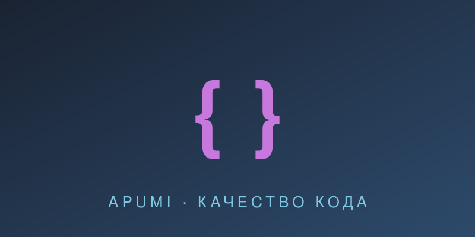

# Code Quality Agent

**38 правил, 0 runtime-зависимостей. Компилятор как истина. SARIF 2.1.0.**

---

## За 30 секунд

**Что это:** CQA — 38 правил, 0 runtime-зависимостей (stdlib). Компилятор как истина (cargo check / tsc / compile), циклы импортов (Tarjan SCC), SARIF 2.1.0.

**Кому:** CI-вендоры, внутренние платформы банков/оборонки — OEM-лицензия.

**Почему сейчас:** Semgrep/Sonar не используют компилятор как ground truth. CQA — использует. Меньше ложных срабатываний.

**Что доказано:** 59 passed. SARIF 2.1.0. Report.errors явно перечисляет, что НЕ проверено. apumia prove → PROVEN.

**Чего не доказано (честно):** Нет taint-анализа, dead code, duplication. Не замена Semgrep/Sonar. AI-слой только с MockClient.

---

## Оффер

OEM-лицензия $1–3K (CI-вендор / внутренняя платформа).

**Следующий шаг:** Покажу SARIF + self-scan — 20 минут.

---

## GitHub

- **Private code:** apumiaaifund/code-quality-agent
- **Public demo:** apumiaaifund/code-quality-agent-demo

## License

MIT

---

### 🛡️ Верификация качества и безопасности (Apumia DevSecOps Gate)

> **Статус:** `VERIFIED & PROVEN` • **Дата аудита:** `16.11.2026`  
> **Контроль архитектуры (`Apumia Blueprint`):** `CLEAN` (`0` циклических зависимостей, контроль сложности McCabe)  
> **Анализ безопасности (`Bandit / Zero-Trust`):** `0` критических уязвимостей  
> **Протокол достоверности (`Apumia Hub`):** `_synthetic: false` | `preservation: 100.0%` | `verified: true`
